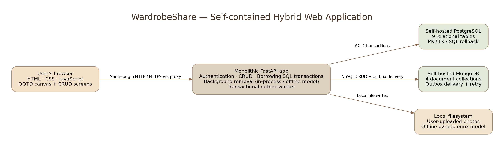
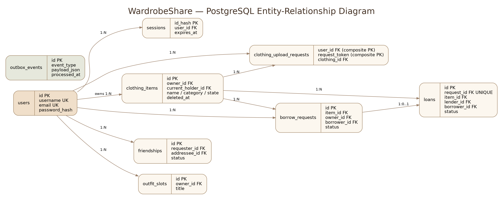
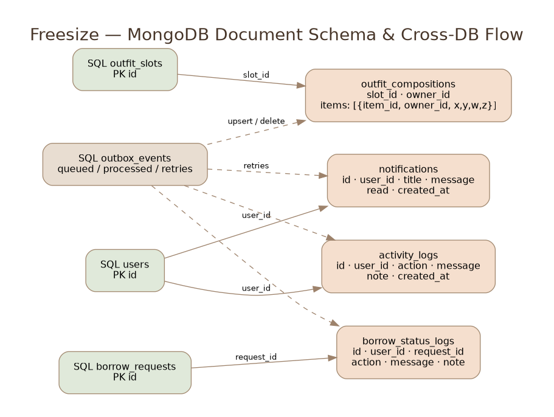

<div align="center">

# Freesize

**Your wardrobe, your friends, endless outfit combinations.**

A self-hosted social wardrobe application for organizing clothing, styling outfits with friends, and keeping track of borrowed items.

**Status:** Working closed-beta deployment on a privately accessed Ubuntu host (Tailscale HTTPS). This is **not** a publicly accessible internet service.

</div>

## Overview

Youtube link: [Freesize](https://youtu.be/pssf54WoNos)
Freesize lets people maintain a digital wardrobe, create and save outfit compositions, discover clothing shared by accepted friends, and manage physical borrowing. Images are stored on the host, not in a third-party storage API. Optional background removal runs inside the Python application with a locally provisioned ONNX model.

### Features

| Module | Functionality |
| --- | --- |
| Accounts & profiles | Register, log in/out, edit profile and avatar, manage account |
| My Wardrobe | Add clothes from a camera or file, edit details, remove items, track owner and current holder |
| OOTD Studio & Gallery | Drag, resize, and layer clothing on a canvas; save, revisit, edit, or delete outfits |
| Friends | Search by username, request/accept/reject friendships, view accessible wardrobes |
| Borrowing | Request an item, approve/reject, hand it over, request return, confirm receipt, view history |
| Notifications & activity | Manage personal reminders, activity/journal entries, and borrowing notes |

**Privacy rule:** When someone views a friend's saved outfit, the server checks access to *every* clothing item in that outfit. If any referenced owner is not accessible to the viewer, the whole outfit (including its preview) is hidden. Putting a garment on a digital canvas never transfers its physical ownership or possession.

## Technology stack

| Layer | Implementation |
| --- | --- |
| Frontend | HTML, CSS, vanilla JavaScript |
| Backend | Python 3.11, FastAPI, Uvicorn |
| Relational database | Self-hosted PostgreSQL 16 |
| Document database | Self-hosted MongoDB 7 |
| Background removal | `rembg` with the U²-NetP ONNX model, running **in-process** and offline |
| File storage | Server filesystem / persistent Docker volume for uploads |
| Containers | Docker and Docker Compose |
| Delivery | GitHub Actions, GHCR image publishing, Ubuntu systemd deploy agent, Tailscale SSH trigger |
| HTTPS | Tailscale HTTPS on the active private deployment; a Caddy-based VPS configuration is also included but is a separate deployment path |

There is **one FastAPI application**, not a separate AI microservice. PostgreSQL and MongoDB are not exposed to the public internet by the supplied local Compose setup.

## System architecture



The browser communicates with the FastAPI application, which handles authentication, permissions, CRUD operations, SQL transactions, image processing, and cross-database synchronization. PostgreSQL holds structured entities and transactional state; MongoDB stores flexible documents; uploaded images and the AI model remain on the local host.

### SQL ER diagram — PostgreSQL



The **nine SQL tables** are:

| Table | Purpose |
| --- | --- |
| `users` | Accounts and profile information |
| `sessions` | Authentication sessions |
| `clothing_items` | Garments, owners, current holders, and item state |
| `clothing_upload_requests` | Deduplicate repeated uploads using user ID + request token |
| `friendships` | Friendship requests and accepted connections |
| `outfit_slots` | Saved outfit identities and owners |
| `borrow_requests` | Borrowing requests and their statuses |
| `loans` | Actual handovers and returns |
| `outbox_events` | Pending or processed events delivered to MongoDB |

The database defines primary/foreign keys and constraints. Borrowing operations use SQL transactions and row locking where appropriate; forced-error tests verify rollback after multi-step modifications. A repeated wardrobe upload with the same request token returns the existing item instead of creating duplicates.

### NoSQL document schema — MongoDB



The **four MongoDB collections** are:

| Collection | Purpose |
| --- | --- |
| `outfit_compositions` | Flexible arrays of positioned/layered outfit items |
| `notifications` | Notifications and user-owned reminders |
| `activity_logs` | Activity events and personal journal entries |
| `borrow_status_logs` | Borrowing events and personal notes |

Example outfit composition (illustrative IDs):

```json
{
  "slot_id": "outfit-slot-id",
  "owner_id": "outfit-owner-id",
  "items": [
    { "item_id": "shirt-id", "owner_id": "shirt-owner-id", "x": 0.1, "y": 0.2, "w": 0.42, "z": 2 },
    { "item_id": "skirt-id", "owner_id": "skirt-owner-id", "x": 0.4, "y": 0.48, "w": 0.36, "z": 3 }
  ]
}
```

The coordinates are normalized for the OOTD canvas. Item ownership is verified against PostgreSQL, not trusted from browser-supplied values. User-owned editable records support their corresponding CRUD operations; system-generated audit/security events are not arbitrarily editable or deletable.

### SQL–NoSQL synchronization

Business updates are committed atomically *within PostgreSQL*, along with an `outbox_events` row. An in-process worker applies the corresponding MongoDB change and can retry delivery using stable identifiers. **This is eventual consistency across the two databases, not a distributed ACID transaction.** PostgreSQL rollback and outbox retry are covered by integration tests.

## Local setup

### Prerequisites

- Docker Engine with the Docker Compose plugin
- Git
- A machine capable of running PostgreSQL, MongoDB, and the Python web image (Ubuntu/Linux recommended)
- Optional: a trusted `u2netp.onnx` model file for offline background removal

### 1. Clone and configure

```bash
git clone https://github.com/ratamon2606-create/freesize.git
cd freesize
cp .env.example .env
mkdir -p models
```

Edit `.env` and **replace** `POSTGRES_PASSWORD` with your own password. The included environment template is for local use, not production secrets. Important options:

| Variable | Local behavior |
| --- | --- |
| `WEB_PORT=3000` | Browser address is `http://localhost:3000` |
| `SEED_DEMO=1` | Seed demo content in a disposable local database; use `0` for a fresh, non-demo database |
| `COOKIE_SECURE=0` | Allows HTTP cookies on localhost; use secure cookies for HTTPS deployments |
| `LOCAL_AI_MODELS_DIR=./models` | Directory containing the optional model weights |
| `REQUIRE_BACKGROUND_AI=0` | Does not require AI model availability for readiness checks |

**Do not commit `.env`, real uploads, database data, SSH keys, or ONNX model weights.**

### 2. Start the application

```bash
docker compose up -d --build
docker compose ps
curl -fsS http://localhost:3000/api/ready
```

Open **http://localhost:3000**. The development web port binds to `127.0.0.1`, so it is not directly exposed as a public web service. Startup may take time on the first build while Docker downloads the required images and Python packages.

### 3. Optional offline AI setup

Place a verified U²-NetP model at:

```text
models/u2netp.onnx
```

The Docker image includes the local inference library, but **the model weights are deliberately excluded from Git**. With `REQUIRE_BACKGROUND_AI=0`, the rest of the app can be used without the weights, but background-removal functionality should not be assumed to work. For an environment that must support background removal, install the model, set `REQUIRE_BACKGROUND_AI=1`, restart/recreate the web service, and test an actual image cutout as well as `/api/ready`. No external inference API is called.

### 4. Shut down the disposable local environment

```bash
docker compose down
```

This stops local containers **without removing named volumes**. Do **not** use `down -v` against a project whose PostgreSQL, MongoDB, or uploaded images you need to keep.

## API overview

The following are application-owned endpoints, not third-party APIs. Most routes require an authenticated session cookie.

| Area | Selected endpoints |
| --- | --- |
| Authentication | `POST /api/auth/register`, `POST /api/auth/login`, `POST /api/auth/logout` |
| Profile | `GET /api/me`, `PATCH /api/me`, `DELETE /api/me`, `POST /api/me/avatar` |
| Wardrobe | `GET /api/wardrobe`, `POST /api/wardrobe`, `PATCH /api/wardrobe/{id}`, `DELETE /api/wardrobe/{id}` |
| Friends | `GET /api/users/search?q=`, `GET /api/friends`, `POST /api/friends`, `PATCH /api/friends/{id}`, `DELETE /api/friends/{id}` |
| OOTD | `GET /api/ootds`, `POST /api/ootds`, `PATCH /api/ootds/{id}`, `DELETE /api/ootds/{id}` |
| Borrowing | `GET /api/borrowing`, `POST /api/borrowing`, `PATCH /api/borrowing/{id}`, `DELETE /api/borrowing/{id}` |
| Notifications / activity | `GET /api/notifications`, `GET /api/activity` and related create/update/delete routes for permitted records |
| Service health | `GET /api/health`, `GET /api/ready` |

In HTTPS environments, mutating browser requests must pass the application's same-origin validation against the configured `PUBLIC_ORIGIN`.

## Testing and GitHub CI

Use the supplied pre-push gate from the repository root on a Docker-capable development machine:

```bash
bash scripts/prepush_gate.sh
```

The gate runs source/static checks, Python/JavaScript validation, preview tests, **real PostgreSQL + MongoDB integration tests**, transactional rollback checks, and a Docker build. It creates a separate disposable Compose project for testing rather than intentionally modifying the live database volumes.

GitHub Actions additionally checks:

1. Unit and API (preview)
2. Browser UI smoke
3. Hybrid DB (PostgreSQL + MongoDB)
4. Build container images
5. Dependency vulnerability audit

A successful CI run on `main` can publish an immutable, commit-tagged web image to GHCR. The repository's branch protection requires a reviewed PR and passing checks before merging. Test results do not replace any genuine screenshots or demonstration evidence separately required by an instructor.

## Screenshots and submission evidence

The screenshots below document the FreeSize user interface and database validation. They were captured on 23 November 2026. User account email in the profile screenshot is redacted for privacy. All screenshots retain their feature context.

**Evidence limits:** A screenshot of an edit form or confirmation dialog shows the UI workflow, but does not by itself prove a successful database update or deletion. The automated database tests and [test evidence](docs/screenshots/evidence/) document transaction rollback and SQL-to-MongoDB recovery on a separate disposable database.

### Web application (23 screenshots)

| Feature | Screenshot evidence |
| --- | --- |
| Home | [Signed-in home dashboard](docs/screenshots/01-home-overview.png) |
| Authentication | [Login page and sign-up entry point](docs/screenshots/02-login-page.png) |
| Profile | [Profile management form (email redacted)](docs/screenshots/03-profile-redacted.png) |
| Wardrobe | [Wardrobe gallery and item controls](docs/screenshots/04-wardrobe-gallery.png) |
| Wardrobe | [Create clothing form](docs/screenshots/05-add-clothing-dialog.png) |
| Wardrobe | [Update clothing form](docs/screenshots/06-edit-clothing-dialog.png) |
| Wardrobe | [Delete confirmation dialog](docs/screenshots/07-delete-clothing-confirmation.png) |
| OOTD | [Saved outfit gallery](docs/screenshots/08-ootd-gallery.png) |
| OOTD | [Drag-and-layer OOTD editor](docs/screenshots/09-ootd-studio.png) |
| OOTD | [Outfit detail and original owner labels](docs/screenshots/10-ootd-preview-ownership.png) |
| Friends | [Friend cards, requests and controls](docs/screenshots/11-friends-list.png) |
| Friends | [Accepted friend wardrobe](docs/screenshots/12-friend-wardrobe.png) |
| Friends | [Accessible friend outfit gallery](docs/screenshots/13-friend-outfits.png) |
| Borrowing | [Borrowing requests page, empty state](docs/screenshots/14-borrowing-requests.png) |
| Borrowing | [Active loan with step-by-step status](docs/screenshots/15-lent-to-friends.png) |
| Borrowing | [Borrowed-by-me tab, empty state](docs/screenshots/16-borrowed-by-me.png) |
| Borrowing | [Returned loan history](docs/screenshots/17-borrowing-history.png) |
| MongoDB UI | [Notifications and reminders](docs/screenshots/18-notifications.png) |
| MongoDB UI | [Activity entries and personal notes](docs/screenshots/19-activity-notes.png) |
| MongoDB UI | [Borrow status log and personal notes](docs/screenshots/20-borrow-status-log.png) |

| Wardrobe | [Successful clothing update](docs/screenshots/27-clothing-update-success.png) |
| Wardrobe | [Successful clothing removal](docs/screenshots/28-clothing-delete-success.png) |
| Activity | [Clothing update and removal audit entries](docs/screenshots/29-clothing-activity-audit.png) |

### Database and integration tests (6 screenshots)

| Verification | Screenshot evidence |
| --- | --- |
| Database | [PostgreSQL table listing (9 tables)](docs/screenshots/21-postgresql-tables.png) |
| Database | [MongoDB collections and document counts](docs/screenshots/22-mongodb-collections.png) |
| Database | [JOIN query results for requests, loans and clothing states](docs/screenshots/23-sql-join-results.png) |
| Testing | [Combined rollback and outbox evidence view](docs/screenshots/24-transaction-and-outbox-combined.png) |
| Testing | [Forced SQL failure with before/after rollback verification](docs/screenshots/25-transaction-rollback.png) |
| Testing | [SQL outbox recovery after transient MongoDB error](docs/screenshots/26-outbox-retry.png) |

The SQL rollback test intentionally raises an exception after two writes, verifies unchanged pre/post SQL state, and confirms no loan record was persisted. The outbox retry test simulates a failed MongoDB write before verifying eventual delivery. The underlying machine-readable files are [rollback-postgres.json](docs/screenshots/evidence/rollback-postgres.json) and [nosql-integration.json](docs/screenshots/evidence/nosql-integration.json).

## Deployment and operations

### Currently used: private Ubuntu laptop/server

The active closed-beta setup uses a **separately configured `freesize-friends` Docker Compose project** (web on local port `3100`, persistent PostgreSQL/MongoDB and uploads) accessed through Tailscale HTTPS. Its host-local `.env.friends` and `compose.friends.yml` contain deployment-specific configuration and are **not part of this public source repository**. Do not attempt to recreate that environment by guessing credentials or hostnames; use the local setup above for a new installation.

Release flow:

```text
Feature branch -> Pull request -> Review + 5 CI checks -> Merge main
-> Successful main CI -> GHCR image publish
-> GitHub Actions Tailscale SSH notification (when enabled)
-> Ubuntu systemd deploy agent -> Verified current-main release
-> Pull immutable image -> Recreate web only -> Health checks
-> Success, or web-image rollback and pause on a failed health check
```

A **30-minute systemd timer** also checks for eligible releases, including when GitHub's notification is unavailable. The agent refuses stale commits, insufficient disk space, missing GitHub release approvals/checks, or unhealthy services. Only the web image is swapped; the deploy process does **not** run `git pull`, rebuild an image locally, or delete PostgreSQL/MongoDB volumes. If `main` changes while the image is being pulled, it leaves the running web unchanged and retries on a future check.

For an **already configured** Ubuntu deploy host, operators can inspect the setup with:

```bash
python3 scripts/freesize_local_deploy.py status
python3 scripts/freesize_local_deploy.py plan
systemctl list-timers freesize-local-deploy.timer
sudo journalctl -u freesize-local-deploy.service -n 60 --no-pager -o cat
docker ps --filter name=freesize-friends
curl -fsS http://127.0.0.1:3100/api/ready
```

Once the host has been configured and verified, controlled deploy operations are:

```bash
# Run one scheduled-agent check now:
sudo systemctl start freesize-local-deploy.service

# Stop/start accepting future automatic releases:
python3 scripts/freesize_local_deploy.py pause
python3 scripts/freesize_local_deploy.py resume

# Roll back to the locally retained previous web image (pauses the agent):
python3 scripts/freesize_local_deploy.py rollback
```

Treat rollback as an operator action: verify the target image and health afterwards. These commands act on the active local host and should not be run blindly on a newly cloned development checkout. Never manually prune the current/rollback image while it is needed for recovery.

The private push trigger is implemented by `.github/workflows/notify-laptop-after-release.yml` and `scripts/install_freesize_push_trigger.sh`. It uses Tailscale networking and a restricted SSH account; **never** commit or paste private SSH keys, OAuth secrets, or host-only environment files. A superseded-release or failed-trigger notification should be investigated from the systemd journal before changing the running service.

### Alternative VPS deployment path

The `deploy/` directory also contains a **separate**, opt-in VPS configuration using Caddy HTTPS, PostgreSQL, MongoDB, pinned GHCR images, health checks, and backup/restore scripts. The `production` job in `.github/workflows/release.yml` is gated by `DEPLOY_ENABLED=true` and must not be treated as the active laptop/Tailscale deployment. VPS provisioning, DNS, secrets, secure model storage, off-host backups and deployment approval are operator responsibilities.

### Backups, restores, and data safety

- Keep backups of **PostgreSQL, MongoDB, and uploaded photos**; an application-image rollback does not restore or reverse database updates.
- The VPS sample `deploy/backup-data.sh` creates per-database dumps and an uploads archive with checksums. This is **not** an atomic snapshot of both databases together, and it does not automatically back up the active laptop deployment.
- Copy encrypted backups to storage **outside** the host, with access controls; test restoration in a separate disposable Compose project before considering a production restore.
- Before any real restore, confirm verified backup files, stop writes, arrange a maintenance window, and assess the recovery point. Never execute destructive restore commands against live data casually.
- Never use `docker compose down -v`, indiscriminate volume pruning, or unreviewed schema changes against a live deployment.

## Repository structure

```text
freesize/
├── README.md
├── app.py
├── Dockerfile
├── docker-compose.yml
├── docker-compose.gate.yml
├── compose.autodeploy.yml
├── requirements.txt
├── requirements-inference.txt
├── .env.example
├── static/                # Web UI, CSS, JavaScript, and image assets
├── tests/                 # API, UI, database, safety and deployment tests
├── scripts/               # Pre-push checks and local deployment agent
├── deploy/                # Optional VPS configuration and backup scripts
├── .github/workflows/     # CI, release, notification and rollback workflows
└── docs/diagrams/         # Required architecture, SQL ERD, Mongo schema PNGs
```

## Collaboration and security notes

Create a feature branch, open a pull request into `main`, allow the GitHub checks to run, and obtain the required review. Do not push directly to protected `main`. For UI changes, test desktop/mobile layout and ensure the backend/database behavior is unchanged. Confirm that `git status` does not include `.env`, personal photographs, private model binaries, credentials, or live database dumps before pushing.

The app is designed for a limited-access student project/closed beta. It is **not claimed to be a fully hardened public SaaS**. Production deployment needs appropriately configured HTTPS, access restrictions, backups, restoration tests, and careful operational review. Internal technical tables and immutable system audit records are not editable by arbitrary users; cross-database consistency is eventual.

**Naming note:** The public-facing project is **Freesize**. Some internal Compose names, database identifiers and paths still use the original `wardrobeshare` name for compatibility.

**License:** No open-source license has been selected. Access to this repository does not imply a grant to reuse its code beyond applicable law and explicit permission.
