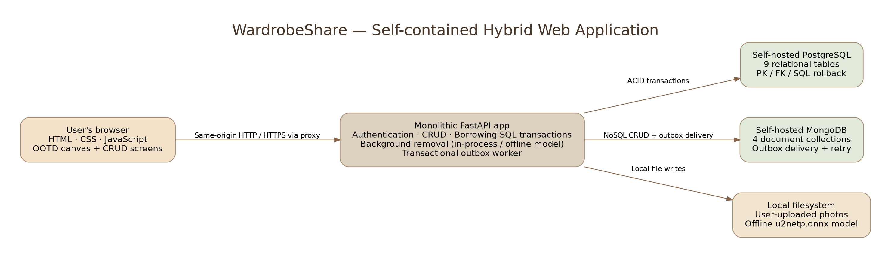

# System Architecture

WardrobeShare runs one FastAPI monolithic web application with a bundled vanilla JS/CSS frontend. Its local PostgreSQL database holds normalized users, wardrobe, borrowing, sessions and outbox rows. Local MongoDB holds four flexible collections. Garment uploads and pre-provisioned model binaries live on self-hosted filesystem volumes. Background removal runs **inside** the FastAPI process using `rembg` when offline ONNX weights are installed; there is no external inference API or second AI HTTP microservice.

SQL transactional outbox records Mongo events in the **same** SQL commit as business operations, retries delivery until successful and uses stable IDs for idempotency. Cross-database state is eventually consistent; there is no claim of a distributed SQL/Mongo atomic transaction.
