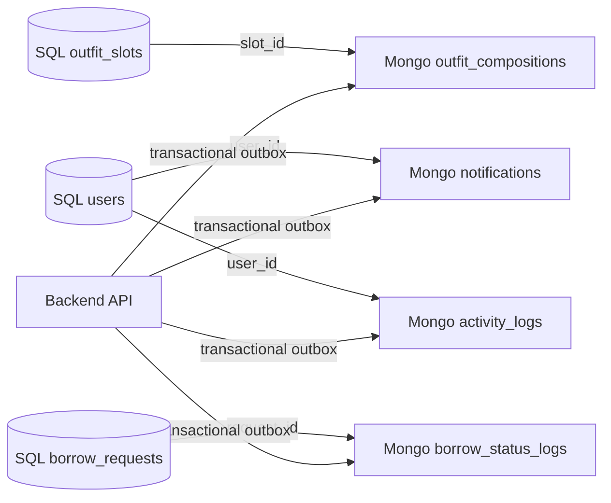
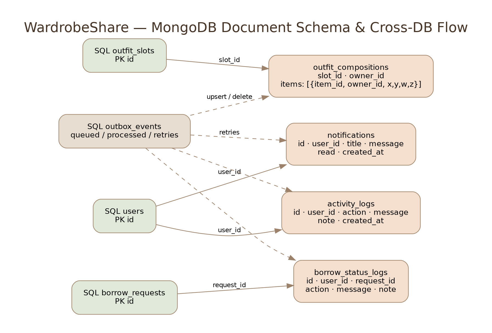

# MongoDB Collection Schema / Flow



Example outfit composition document:

```json
{
  "slot_id": "uuid32",
  "owner_id": "user-uuid32",
  "items": [
    {"item_id":"clothing-id", "owner_id":"original-owner-id", "x":0.1, "y":0.2, "w":0.42, "z":2},
    {"item_id":"another-id", "owner_id":"friend-owner-id", "x":0.4, "y":0.48, "w":0.36, "z":3}
  ]
}
```

`x, y, w` are canvas-normalized coordinates. `owner_id` is always resolved from SQL when saving — the browser cannot forge an owner reference. The server compares **all** `owner_id` values with the viewer and accepted-friend IDs before returning another person's saved OOTD.

## Rendered collection flow and CRUD



All four collections support create/read/update/delete via web UI on **user-owned editable records**: OOTD compositions (via OOTD Gallery), personal reminders, personal journal entries, and personal borrowing notes. System-generated security/audit events remain immutable and are not exposed for arbitrary deletion; actual Mongo CRUD is verified in the hybrid tests.
