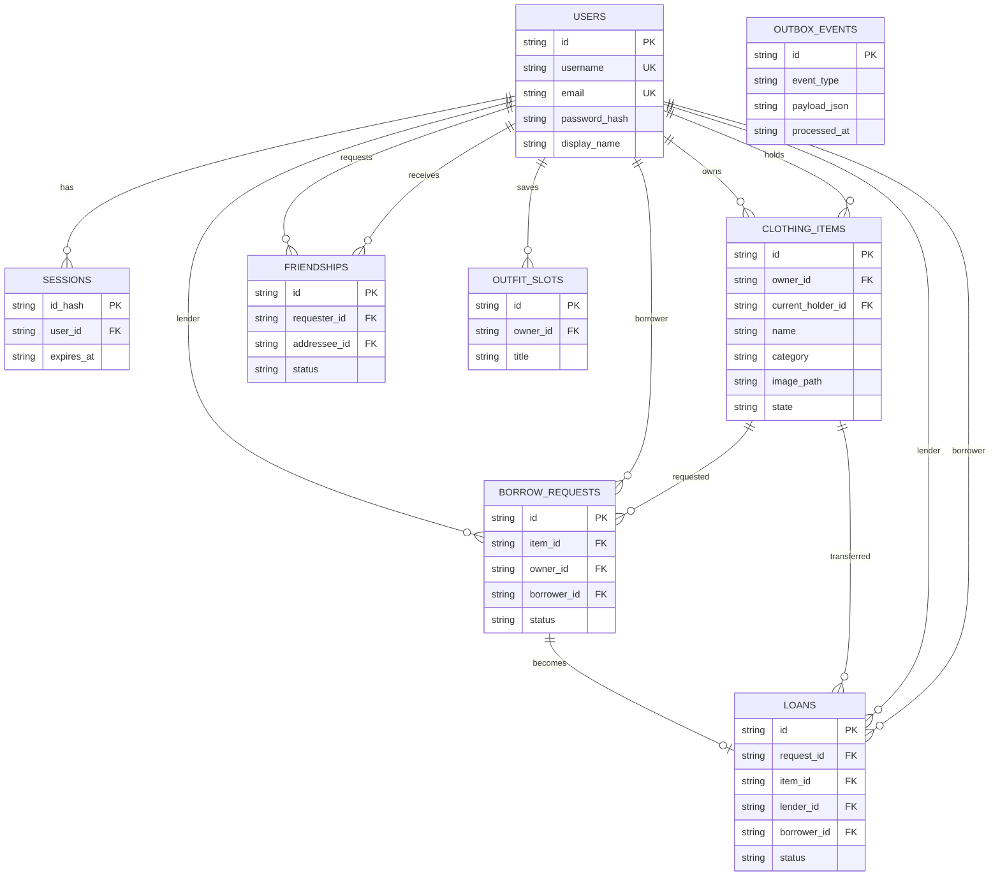
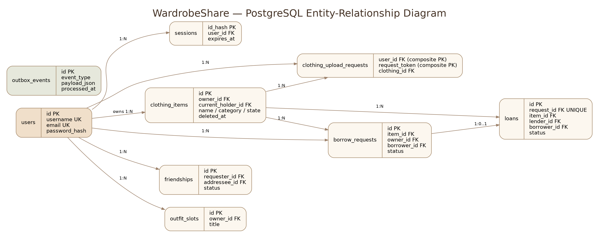

# SQL ER Diagram

Primary/foreign-key constraints are created by `SQL_SCHEMA` inside `app.py`. Application-level `FOR UPDATE` locking in PostgreSQL and transactional mutations prevent conflicting handovers.

## Upload retry protection (v1.2)

New SQL table `clothing_upload_requests`:

- `user_id` (FK -> `users.id`)
- `request_token` (client-generated token per upload form)
- `clothing_id` (FK -> `clothing_items.id`)
- `created_at`
- composite PRIMARY KEY (`user_id`, `request_token`)

A repeated POST for the same user and token returns the prior item rather than creating another item or activity event. The first row is written atomically with the clothing item and its outbox event. Existing databases are migrated non-destructively with `CREATE TABLE IF NOT EXISTS`.

## Rendered diagram

PostgreSQL enforces one reserved or borrowed request per item and one active loan per item using **partial unique indexes**; otherwise `FOR UPDATE` locks protect borrowing transitions. `sessions`, upload deduplication requests and outbox rows are internal system entities.
